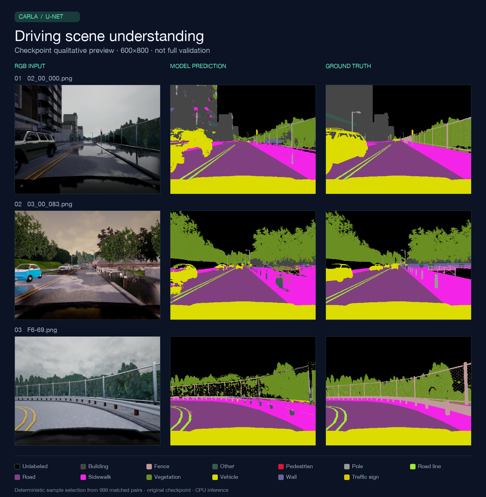
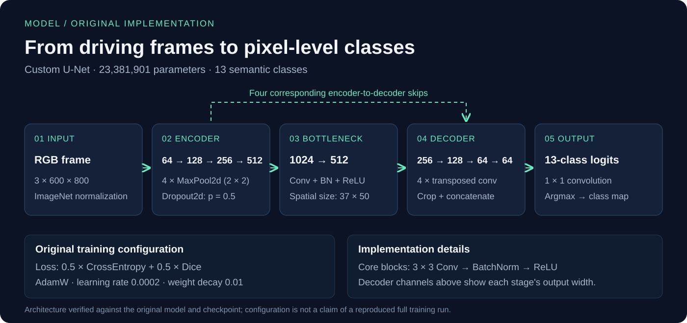

# CARLA Road Scene Semantic Segmentation

**주행 장면의 모든 픽셀을 13개 클래스로 분류하는 PyTorch U-Net 프로젝트**

도로·차량·보행자·차선 등 주변 환경을 구분하기 위해 U-Net을 구성하고, optimizer와 loss, 학습률, batch size를 비교한 자동차인공지능 팀 프로젝트입니다. 실험 설정부터 학습·평가·예측 시각화까지의 흐름을 담았습니다.

`Python` · `PyTorch` · `Computer Vision` · `Semantic Segmentation` · `U-Net`

| 프로젝트 | 내용 |
| --- | --- |
| 진행 | 2025학년도 2학기 자동차인공지능 수업 · 경규진, 조민규 2인 팀 |
| 조민규 담당 | **모델 설계·구현·학습** |
| 입력 → 출력 | RGB 600×800(H×W) → 13개 클래스의 픽셀 단위 분할 |
| 모델 | 직접 구성한 U-Net · **23,381,901 parameters** · 외부 사전학습 가중치 없이 학습 |
| 제출 설정 | AdamW + Cross-Entropy/Dice hybrid loss |
| 기록된 validation mIoU | **A4 제출 설정 54.85%** · 실험 표 최고 A6 **55.14%** |
| 포트폴리오 정리 | 2026년 10월 · 원본 보존, 실행 경로 정리, 데이터 검사, 테스트 추가 |

> 성능은 **수정본 발표 자료에 기록된 validation 결과**입니다. 이번 정리 과정에서 전체 데이터로 재측정한 성능이나 독립 test 성능을 뜻하지 않습니다. 원본 실험과 정리본 변경을 [재현 안내](docs/reproducibility.md)에 구분했습니다.

## 실제 예측 결과



보관된 `A4_2` 가중치로 **600×800 원본 크기**에서 다시 추론한 결과입니다. 정렬된 검증 파일 목록의 0·333·666번째 세 장을 사용했으며, 보기 좋은 결과를 기준으로 고르지 않았습니다. 넓은 도로·식생·차량 영역과 함께 울타리·기둥 및 경계의 오분류도 확인할 수 있습니다. [샘플·환경·체크포인트 정보](results/preview-metadata.json)

## 해결하려 한 문제와 구현

자율주행 환경 인식에서는 이미지에 어떤 객체가 있는지뿐 아니라 **각 객체가 차지하는 영역과 경계**를 알아야 합니다. 제한된 과제용 데이터에서 큰 영역과 작은 객체를 함께 구분하도록 모델과 학습 조건을 설계했습니다.

- **공간 정보 복원:** encoder에서 추출한 특징을 decoder의 같은 해상도 특징과 연결하는 U-Net skip connection을 구현했습니다. 전치 합성곱 뒤 크롭으로 특징맵 크기를 맞췄습니다.
- **픽셀 분류와 영역 겹침의 결합:** Cross-Entropy와 Dice loss를 0.5:0.5로 결합하고 Focal+Dice 조합과 비교했습니다.
- **학습 조건 비교:** AdamW/SGD, loss, 학습률, batch size를 바꾼 12개 실험 결과를 기록했습니다.
- **과적합 대응:** BatchNorm, Dropout2d(p=0.5), weight decay와 validation loss 기반 early stopping을 사용했습니다.
- **평가와 확인:** macro mIoU와 RGB·예측·정답 시각화를 함께 확인했습니다.

### 담당 역할 — 조민규

**모델 설계·구현·학습을 담당했습니다.** U-Net 기반 분할 모델을 구성하고 학습을 진행하며, loss와 optimizer를 포함한 학습 설정을 다뤘습니다. 위 실험 수치는 2인 팀 프로젝트의 결과이며 개인의 단독 성과나 정량적인 기여율로 환산하지 않습니다.

## 모델과 학습 설정



encoder 채널은 `3 → 64 → 128 → 256 → 512 → 1024`이며, 네 단계의 downsampling과 skip connection을 사용합니다. 최종 1×1 convolution은 13개 클래스의 logits를 출력합니다. [모델 코드](src/carla_seg/model.py) · [제출 설정](configs/final.json)

| 설정 | 값 |
| --- | --- |
| Optimizer | AdamW, learning rate `2e-4`, weight decay `0.01` |
| Loss | `0.5 × Cross-Entropy + 0.5 × multiclass Dice` |
| Batch / Epoch | 4 / 최대 100, early stopping patience 10 |
| 입력 전처리 | 600×800, ImageNet mean/std 정규화 |
| 라벨 전처리 | red channel class ID, nearest resize, 255 → 0 |
| 클래스 | Unlabeled, Building, Fence, Other, Pedestrian, Pole, Road line, Road, Sidewalk, Vegetation, Vehicle, Wall, Traffic sign |

## 실험에서 확인한 점

수정본 발표 자료의 대표 비교입니다. 전체 12개 결과는 [CSV](results/experiments.csv), 자료의 출처와 차이는 [실험 기록](docs/experiment-notes.md)에 정리했습니다.

| Case | Optimizer | Loss | LR | Batch | Validation mIoU |
| --- | --- | --- | ---: | ---: | ---: |
| A1 | AdamW | Focal + Dice | 0.0001 | 4 | 51.43% |
| A2 | AdamW | CE + Dice | 0.0001 | 4 | 53.15% |
| **A4 · 제출** | **AdamW** | **CE + Dice** | **0.0002** | **4** | **54.85%** |
| A5 | AdamW | CE + Dice | 0.0002 | 8 | 53.98% |
| A6 · 표 최고 | AdamW | CE + Dice | 0.0002 | 2 | 55.14% |
| S4 · SGD 최고 | SGD | CE + Dice | 0.01 | 4 | 53.42% |

1. **Loss 선택:** 같은 AdamW 설정의 A1/A2에서 CE+Dice가 Focal+Dice보다 1.72%p 높게 기록됐습니다.
2. **학습률 조정:** A2에서 학습률을 두 배로 늘린 A4는 1.70%p 높았고, 발표 표의 수렴 epoch는 29에서 21로 줄었습니다.
3. **Batch size 비교:** A6가 A4보다 0.29%p 높지만 validation loss는 0.4175에서 0.4647로 증가했습니다. 발표에서 강조한 제출 설정은 A4이며, 이를 최고 mIoU 모델로 표현하지 않습니다.

각 수치는 보관된 단일 실험 기록입니다. 반복 실험의 평균, 통계적 우위 또는 모든 환경에서의 일반적인 결론을 뜻하지 않습니다.

## 실행 방법

### 1. 환경 준비

Python 3.10 이상이 필요합니다. 로컬 검증은 Python 3.13 / PyTorch 2.9.1 / CPU에서 수행했습니다. GPU를 사용한다면 환경에 맞는 [PyTorch 설치 안내](https://pytorch.org/get-started/locally/)를 먼저 확인하세요.

```bash
git clone https://github.com/mkcho22/carla-semantic-segmentation.git
cd carla-semantic-segmentation
python -m venv .venv
source .venv/bin/activate
python -m pip install -e .
```

Windows에서는 가상환경 활성화 명령을 `.venv\Scripts\activate`로 바꿉니다. 정리본의 실행 의존성은 PyTorch, NumPy, Pillow입니다.

### 2. 데이터 검사

과제에서 사용한 데이터의 출처는 [Semantic Segmentation for Self Driving Cars](https://www.kaggle.com/datasets/kumaresanmanickavelu/lyft-udacity-challenge)입니다. 전체 데이터는 저장소에 포함하지 않습니다. [폴더 구조와 클래스 규칙](docs/reproducibility.md#데이터-준비)에 맞춰 별도로 준비하세요.

```bash
python -m carla_seg inspect-data --data-dir "../2D Segmentation"
```

보관된 로컬 스냅샷에는 **Training 1,000쌍, Validation 999쌍**이 있습니다. 검증 RGB 1,000장 중 `F9-99.png`에 대응하는 Label이 없어 위 검사는 이를 보고하며 실패합니다. 누락 샘플 제외에 동의한 실행에는 명시적으로 `--skip-missing`을 추가합니다.

### 3. 학습

```bash
python -m carla_seg train \
  --data-dir "../2D Segmentation" \
  --output-dir runs/final \
  --epochs 100 --batch-size 4 --device auto --seed 42 \
  --skip-missing
```

`best.pt`, `last.pt`, `history.csv`, `config.json`이 저장됩니다. 기본 입력은 600×800입니다. 축소 해상도로 실행한 결과는 발표 성능과 직접 비교하지 않습니다. 누락 파일을 보완했다면 `--skip-missing`을 제거하세요.

### 4. 평가와 예측

```bash
python -m carla_seg evaluate \
  --data-dir "../2D Segmentation" \
  --weights runs/final/best.pt \
  --output results/evaluation.json --skip-missing

python -m carla_seg predict \
  --data-dir "../2D Segmentation" \
  --weights runs/final/best.pt \
  --output assets/my-predictions.png --count 3 --skip-missing
```

원본 가중치를 보유하고 있다면 `--weights weights/segmentation_model_A4_2.pth`로 바꿀 수 있습니다. 약 89 MiB의 원본 가중치는 Git에 포함하지 않았으며 공개 다운로드 링크는 제공하지 않습니다. [체크포인트 식별 정보](archive/source-manifest.json)

### 5. 테스트

```bash
python -m unittest discover -s tests -v
```

## 저장소 구성

```text
src/carla_seg/          모델·데이터·학습·평가·예측 CLI
configs/final.json     원본 제출 설정을 읽기 쉽게 정리한 참고 파일
tests/                 데이터 대응·라벨·지표·모델 동작 검증
assets/                실제 예측 비교와 모델 다이어그램
results/               수정 발표의 실험 표, 예측 이미지 생성 정보
docs/                  실험 근거, 데이터 준비, 재현 범위와 수정 내역
archive/submission/    2025년 최종 제출 Python 코드 보존
```

## 한계와 다음 단계

validation으로 설정을 선택했으며 독립 test-set 성능과 실제 도로 일반화는 확인하지 않았습니다. 작은 객체·경계 오류를 클래스별 IoU로 분석하고, 누락 라벨을 보완한 고정 split에서 여러 seed와 통제된 ablation을 수행하는 것이 다음 단계입니다. 실제 차량 적용을 위해서는 별도의 데이터와 추론 지연·안전성 검증이 필요합니다.

## 출처와 크레딧

- 프로젝트: **경규진 · 조민규**, 2025학년도 2학기 자동차인공지능 팀 프로젝트. 포트폴리오 관리: [조민규 / mkcho22](https://github.com/mkcho22).
- 모델 배경: Ronneberger et al., [U-Net: Convolutional Networks for Biomedical Image Segmentation](https://arxiv.org/abs/1505.04597), 2015. 이 저장소의 모델은 도로 장면용 커스텀 구현입니다.
- 데이터 출처: [Kaggle — Semantic Segmentation for Self Driving Cars](https://www.kaggle.com/datasets/kumaresanmanickavelu/lyft-udacity-challenge). 과제용 split의 전체 데이터는 재배포하지 않습니다.
- 라벨 정의: [CARLA 0.8.4 semantic segmentation](https://carla.readthedocs.io/en/0.8.4/cameras_and_sensors/#camera-semantic-segmentation). 생성에 사용된 정확한 시뮬레이터 버전을 확정한 것은 아닙니다.
- 원본 코드, 수정본 발표와 실험 계획의 관계: [실험 근거](docs/experiment-notes.md), [원본 보존 안내](archive/README.md).

별도의 오픈소스 라이선스는 부여하지 않았습니다. 데이터 및 외부 자료의 권리는 각 권리자에게 있습니다.
